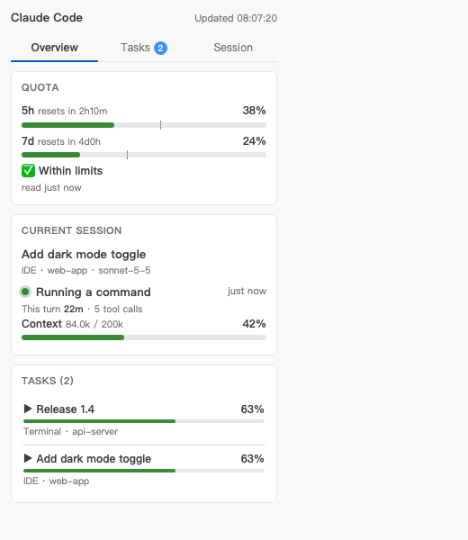
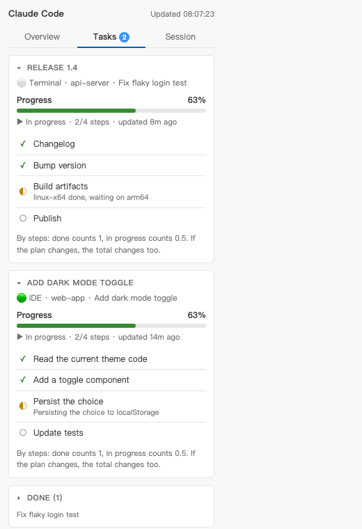
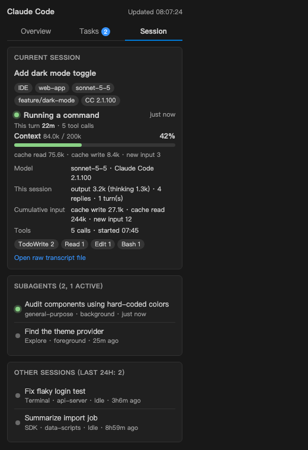

# Claude Code Panel

A side panel and status bar for [Claude Code](https://docs.claude.com/en/docs/claude-code) in **VS Code and Cursor**.
See at a glance what Claude is doing, how far a task has got, how full the context is, and how much of your 5-hour and weekly quota is left.

It reads local files. There is no telemetry, and nothing is installed into Claude Code unless you ask for it.

<p>



</p>

English / [简体中文](README.zh-CN.md)

## What you get

- **Status bar**: `5h 38% · 7d 24% · 63% · Running a command`. Quota, task progress and the current action in one line. It turns yellow or red as you approach your limits.
- **Overview**: quota bars with a marker for even pace, the current session, and your active tasks.
- **Tasks**: one card per task, each showing which session it belongs to. Cards fold down to the current step. Finished tasks tuck away after 30 minutes.
- **Session**: model, context usage, output / cache / input totals, tool counts, subagents, and the other sessions from the last 24 hours (click one to pin it).
- **Adapts to the panel width**: narrow sidebar, wide editor tab, light and dark themes.
- **English and Simplified Chinese**, chosen from the editor's display language.

## Install

Download `claude-code-panel-<version>.vsix` from the [Releases page](https://github.com/karin-lin/claude-code-panel/releases), then:

```
code --install-extension claude-code-panel-0.1.0.vsix      # VS Code
cursor --install-extension claude-code-panel-0.1.0.vsix    # Cursor
```

Or in the editor: Extensions view, `...` menu, **Install from VSIX...**. Reload the window afterwards.

To build it yourself: `npm run package` (needs Node 18+; no dependencies to install).

## Quota setup

The first time it runs, the panel asks where the quota numbers should come from. You can change this any time with **Claude Code Panel: Set up quota**.

| Source | How it works | Network |
|---|---|---|
| **Local file** | Reads a JSON file. The optional **statusline helper** writes it for you whenever the Claude Code terminal renders its status line. | none |
| **Anthropic usage API** | Reads your Claude Code login token and asks Anthropic's usage endpoint about every 5 minutes. Read only, never refreshes your token, backs off when rate limited. | yes |
| **Off** | No quota card. | none |

The usage endpoint is not a documented public API and may change. The statusline helper only runs in the interactive terminal; editors that run Claude Code in the background may not trigger it, in which case use the API source or write the file yourself ([docs/CUSTOMIZING.md](docs/CUSTOMIZING.md)).

The helper edits your `settings.json` only after you confirm, keeps a backup next to it, and keeps your existing status line working. **Claude Code Panel: Uninstall statusline helper** puts everything back.

## Tasks

The panel picks up, with no setup:

1. Claude Code's built-in to-do list (the `TodoWrite` tool) for every recent session.
2. Progress files you write yourself, from any script or tool. See [docs/CUSTOMIZING.md](docs/CUSTOMIZING.md) and [examples/progress.js](examples/progress.js).

Progress is `done steps / total steps`, with a step in progress counting half. It tells you how far through the plan Claude is. It does not predict how long the rest will take, and if the plan grows the percentage honestly drops.

## Settings

| Setting | Default | |
|---|---|---|
| `claudeCodePanel.claudeDir` | empty | Claude Code config dir. Empty means `$CLAUDE_CONFIG_DIR` or `~/.claude`. |
| `claudeCodePanel.pollSeconds` | 5 | How often local files are re-read. |
| `claudeCodePanel.contextWindow` | 200000 | Used for the context percentage. Grows to 1M automatically if a request exceeds it. |
| `claudeCodePanel.quota.source` | ask | `ask`, `off`, `file` or `api`. |
| `claudeCodePanel.quota.file` | empty | Your own quota JSON file (default: the statusline helper's file). |
| `claudeCodePanel.quota.apiIntervalSeconds` | 300 | Minimum seconds between API requests (floor 120). |
| `claudeCodePanel.quota.warnAt` / `critAt` | 80 / 95 | Yellow and red thresholds. |
| `claudeCodePanel.quota.lines` | `{}` | Personal limit lines, e.g. `{"five_hour": 65, "seven_day": 70}`. Draws a tick and counts the distance. |
| `claudeCodePanel.progressFiles` | `[]` | Extra progress files or folders. |

## Which session does it show?

The panel follows the most active session. Sessions in the folder you have open win over sessions elsewhere. Click a session under "Other sessions" to pin it; **Unpin** returns to automatic. The editor does not tell extensions which chat tab has focus, so switching tabs does not switch the panel; sending a message in another session does.

## Privacy

- Reads `<claude dir>/projects/**/*.jsonl` (Claude Code's session transcripts) on your machine. Session titles and tool names are shown in the panel; transcript contents are not sent anywhere.
- The only network feature is the optional quota API source, off until you choose it.
- No analytics, no telemetry.

## Limitations

- It relies on the format of Claude Code's local transcripts, which is not a stable public interface. A Claude Code update may break parts of it; please open an issue.
- `TaskCreate` / `TaskUpdate` (the newer task tools) are replayed on a best-effort basis for the current session only. `TodoWrite` is the well-tested path.
- Developed and tested on macOS with Cursor. VS Code, Windows and Linux should work but have had less testing.
- "Waiting for your approval" is a guess: a tool call that has been pending for over 30 seconds looks the same as a slow command.

## Contributing

`npm test` runs the whole suite on fake data. `npm run demo` renders screenshots from fake data (needs Chrome). The panel logic lives in `lib/` as plain functions with no editor dependency.

## License

MIT. Not affiliated with or endorsed by Anthropic.
