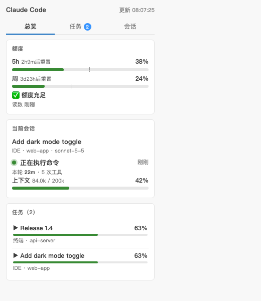
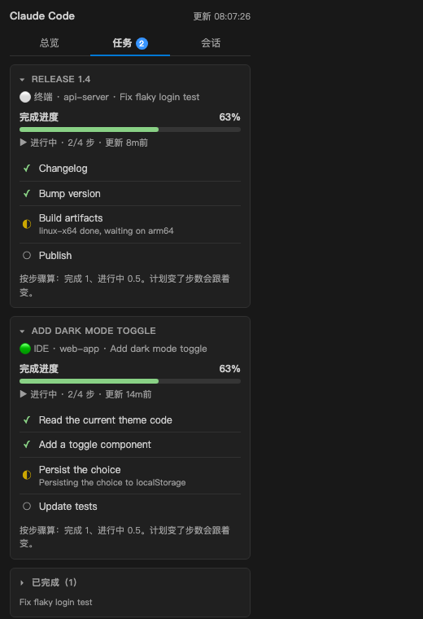
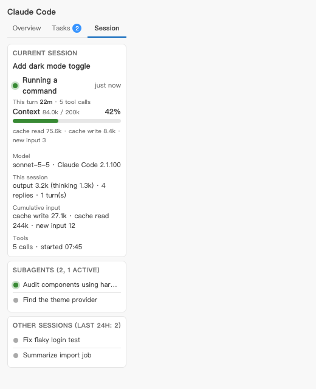

# Claude Code Panel

在 **VS Code 和 Cursor** 里给 [Claude Code](https://docs.claude.com/en/docs/claude-code) 加一个侧边面板和状态栏。
一眼看到 Claude 正在做什么、任务走到第几步、上下文用了多少、5 小时和周额度还剩多少。

只读本地文件，没有任何遥测，不会往 Claude Code 里装任何东西（除非你主动要求）。

<p>



</p>

[English](README.md) / 简体中文

## 功能

- **状态栏**：`5h 38% · 周 24% · 63% · 正在执行命令`，额度、任务进度、当前动作一行看完，接近上限会变黄变红。
- **总览**：额度条（带「匀速」刻度）、当前会话、进行中的任务。
- **任务**：每个任务一张卡，写明属于哪个会话；卡片可折叠到只剩当前一步；完成超过 30 分钟的自动收起。
- **会话**：模型、上下文占用、输出 / 缓存 / 输入统计、工具次数、子 agent，以及 24 小时内的其他会话（点一条可固定）。
- **自适应宽度**：窄侧栏、宽编辑区、深浅主题都能用。
- **中英文界面**，跟随编辑器的显示语言。

## 安装

从 [Releases 页面](https://github.com/karin-lin/claude-code-panel/releases) 下载 `claude-code-panel-<版本>.vsix`：

```
code --install-extension claude-code-panel-0.1.0.vsix      # VS Code
cursor --install-extension claude-code-panel-0.1.0.vsix    # Cursor
```

也可以在编辑器里：扩展视图右上角 `...`，**从 VSIX 安装...**。装完重载窗口。

自己打包：`npm run package`（需要 Node 18+，没有依赖要装）。

## 额度怎么设置

第一次运行会问你额度数字从哪来，之后随时可以用命令 **Claude Code Panel: Set up quota** 改。

| 来源 | 原理 | 联网 |
|---|---|---|
| **本地文件** | 读一个 JSON 文件。可选的**状态栏助手**会在终端里 Claude Code 渲染状态栏时替你写这个文件。 | 否 |
| **Anthropic 额度接口** | 读取你的 Claude Code 登录令牌，大约每 5 分钟请求一次 Anthropic 的额度接口。只读，不刷新令牌，被限流会退避。 | 是 |
| **关闭** | 不显示额度。 | 否 |

额度接口不是官方公开 API，可能随时变化。状态栏助手只在交互式终端里运行；在编辑器后台运行 Claude Code 时可能不会触发，这时请用接口来源，或者自己写文件（见 [docs/CUSTOMIZING.md](docs/CUSTOMIZING.md)）。

助手只在你确认后才修改 `settings.json`，旁边留备份，并保留你原来的状态栏。**Claude Code Panel: Uninstall statusline helper** 可以一键还原。

## 任务进度

不用配置就能读到：

1. Claude Code 自带的待办清单（`TodoWrite` 工具），所有近期会话。
2. 你自己的进度文件，任何脚本或工具都能写。见 [docs/CUSTOMIZING.md](docs/CUSTOMIZING.md) 和 [examples/progress.js](examples/progress.js)。

进度 = 完成步数 / 总步数，进行中的一步算一半。它表示走到计划的第几步，不预测还要多久；计划变长了，百分比会如实下降。

## 面板显示哪个会话？

跟随最活跃的会话，你当前打开的文件夹里的会话优先。点「其他会话」里的一条可以固定，**Unpin** 恢复自动。编辑器不会告诉扩展你聚焦了哪个聊天标签，所以切标签不会换，在另一个会话里发消息才会换。

## 隐私

- 读取本机 `<claude 目录>/projects/**/*.jsonl`（Claude Code 的会话记录）。面板里只显示会话标题、工具名，记录内容不会发到任何地方。
- 唯一的联网功能是可选的额度接口来源，你选了才启用。
- 没有统计，没有遥测。

## 局限

- 依赖 Claude Code 本地会话记录的格式，这不是稳定的公开接口，Claude Code 更新后可能有部分功能失效，欢迎提 issue。
- `TaskCreate` / `TaskUpdate`（较新的任务工具）只对当前会话做尽力而为的重放；`TodoWrite` 是测试最充分的路径。
- 在 macOS + Cursor 上开发和测试；VS Code、Windows、Linux 应该能用，但测试较少。
- 「可能在等你确认」是猜测：工具调用挂起超过 30 秒，和一个很慢的命令看起来一样。

## 许可

MIT。与 Anthropic 无隶属或背书关系。
